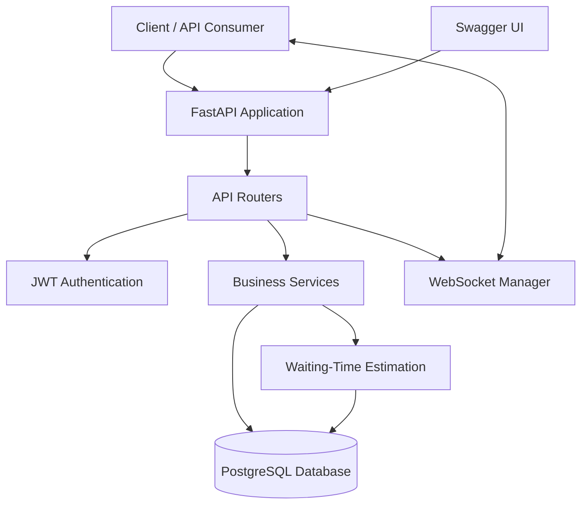

# QueueLess — Queue Management System

A FastAPI-powered backend system designed to simplify queue management through REST APIs, JWT authentication, WebSocket communication, and waiting-time estimation.

## Overview

QueueLess is a backend application designed to manage service queues digitally. It provides functionality for managing users and services, handling queue entries, tracking queue progress, and estimating customer waiting times.

The project demonstrates practical backend development using FastAPI and PostgreSQL, with a focus on API design, authentication, database integration, and modular architecture.

## Key Features

- **User Management:** Provides APIs for creating and retrieving user information.
- **JWT Authentication:** Implements token-based authentication for protected endpoints.
- **Service Management:** Supports creating and retrieving services.
- **Queue Management:** Supports queue creation and customer queue entries.
- **Queue Status Tracking:** Allows customers to check queue status and progress.
- **Waiting-Time Estimation:** Includes logic for estimating customer waiting times.
- **Queue Processing:** Supports serving queue entries and finishing service.
- **WebSocket Support:** Includes a dedicated module for WebSocket connection management.
- **PostgreSQL Integration:** Uses PostgreSQL for persistent relational data storage.
- **Automated Testing:** Includes tests for application behavior.

## Technology Stack

| Technology | Purpose |
|---|---|
| Python | Backend programming language |
| FastAPI | REST API development |
| PostgreSQL | Relational database |
| SQLAlchemy | Database ORM |
| Pydantic | Request and response validation |
| JWT | Token-based authentication |
| WebSockets | Real-time communication |
| Pytest | Automated testing |

## Architecture Diagram

The following diagram illustrates the main components and interactions within QueueLess.



### Architecture Components

- **Client:** Sends HTTP requests and can establish WebSocket connections where supported.
- **FastAPI Application:** Receives requests and coordinates application functionality.
- **API Routers:** Organize authentication, user, service, and queue endpoints.
- **JWT Authentication:** Verifies access tokens for protected operations.
- **Business Services:** Handle queue-related application logic.
- **PostgreSQL:** Stores persistent application data.
- **Waiting-Time Estimation:** Calculates estimated waiting times using queue-related data.
- **WebSocket Manager:** Manages WebSocket connections for real-time communication.

*The diagram is a high-level representation of the architecture; individual interactions depend on the implementation.*

## API Endpoints

The following methods and paths match the endpoints displayed in the QueueLess Swagger UI. The endpoints have been checked by the project author.

### Users

| Method | Endpoint | Description |
|---|---|---|
| GET | `/users/` | List users |
| POST | `/users/` | Create a user |
| GET | `/users/me` | Get the current user's information |
| GET | `/users/{user_id}` | Get a user by ID |

### Services

| Method | Endpoint | Description |
|---|---|---|
| GET | `/services/` | Get services |
| POST | `/services/` | Create a service |
| GET | `/services/{service_id}` | Get a service by ID |

### Queues

| Method | Endpoint | Description |
|---|---|---|
| GET | `/queues/` | Get queues |
| POST | `/queues/` | Create a queue |
| GET | `/queues/{queue_id}/status` | Get queue status |
| GET | `/queues/{queue_id}` | Get a queue by ID |
| POST | `/queues/{queue_id}/join` | Join a queue |
| POST | `/queues/{queue_id}/serve` | Serve the next queue entry |
| POST | `/queues/{queue_id}/finish` | Finish service for a queue entry |
| GET | `/queues/{queue_id}/entries` | Get queue entries |

### Authentication

| Method | Endpoint | Description |
|---|---|---|
| POST | `/auth/login` | Authenticate a user and obtain an access token |

### General

| Method | Endpoint | Description |
|---|---|---|
| GET | `/` | Check whether the application is running |

**Authentication:** Protected endpoints require a valid access token when configured to do so. Use the Authorize option in Swagger UI to supply your token.

**Interactive API documentation:** Start the application and visit `http://127.0.0.1:8000/docs` to inspect request schemas, parameters, and responses.

## Project Structure

```text
QueueLess/
├── app/
│   ├── main.py
│   ├── core/
│   │   └── security.py
│   ├── database/
│   │   ├── database.py
│   │   └── models.py
│   ├── schemas/
│   │   ├── user.py
│   │   ├── service.py
│   │   └── queue.py
│   ├── routers/
│   │   ├── auth.py
│   │   ├── users.py
│   │   ├── services.py
│   │   └── queues.py
│   ├── services/
│   │   ├── queue_service.py
│   │   └── estimation.py
│   ├── websocket/
│   │   └── manager.py
│   └── tests/
├── .env
├── .gitignore
├── requirements.txt
└── README.md
```

## Getting Started

### Prerequisites

- Python
- PostgreSQL
- Git

### 1. Clone the repository

```bash
git clone https://github.com/GangotriTadiboina/QueueLess.git
cd QueueLess
```

### 2. Create and activate a virtual environment

On Windows PowerShell:

```powershell
python -m venv venv
.\venv\Scripts\Activate.ps1
```

### 3. Install dependencies

```bash
python -m pip install -r requirements.txt
```

### 4. Configure environment variables

Create a `.env` file in the project root and configure the variables expected by your application.

Example template:

```env
DATABASE_URL=your_database_connection_url
TEST_DATABASE_URL=your_test_database_connection_url
SECRET_KEY=your_secret_key
ALGORITHM=your_jwt_algorithm
ACCESS_TOKEN_EXPIRE_MINUTES=your_token_expiry_minutes
```

Replace the placeholders with valid values for your environment. Never commit real credentials or secret keys to GitHub. Use a separate test database for automated tests.

### 5. Run the application

From the project root:

```bash
uvicorn app.main:app --reload
```

Use the import path that matches your working project configuration.

The application should be accessible at:

`http://127.0.0.1:8000`

### 6. Explore the API

- **Swagger UI:** `http://127.0.0.1:8000/docs`
- **ReDoc:** `http://127.0.0.1:8000/redoc`

Use Swagger UI to explore the endpoints, provide request data, authenticate where required, and inspect API responses.

## Testing

QueueLess includes automated tests for application behavior.

If your tests are located in `app/tests/`, run:

```bash
python -m pytest app/tests -v
```

Configure the test database before running tests. Verify the current test results before reporting a passing-test count.

## Security and Configuration

- Keep database credentials and secret keys in environment variables.
- Do not commit `.env` files containing sensitive information.
- Use a dedicated database for automated tests.
- Protect restricted endpoints with appropriate authentication and authorization.
- Avoid exposing credentials or access tokens in logs and public documentation.

## Future Improvements

Potential enhancements include:

- A customer-facing web interface.
- A staff dashboard for queue operations.
- Notifications when a customer's turn approaches.
- Containerized deployment.
- Cloud deployment with monitoring and logging.

These are potential future improvements, not claims about existing functionality.

## Author

**Pavana Gangotri Tadiboina**

- GitHub:   https://github.com/GangotriTadiboina
- LinkedIn: https://www.linkedin.com/in/pavana-gangotri-tadiboina-48203034a/

---

*QueueLess is a FastAPI-powered backend system designed to simplify queue management through structured APIs, PostgreSQL integration, secure authentication, and real-time communication.*